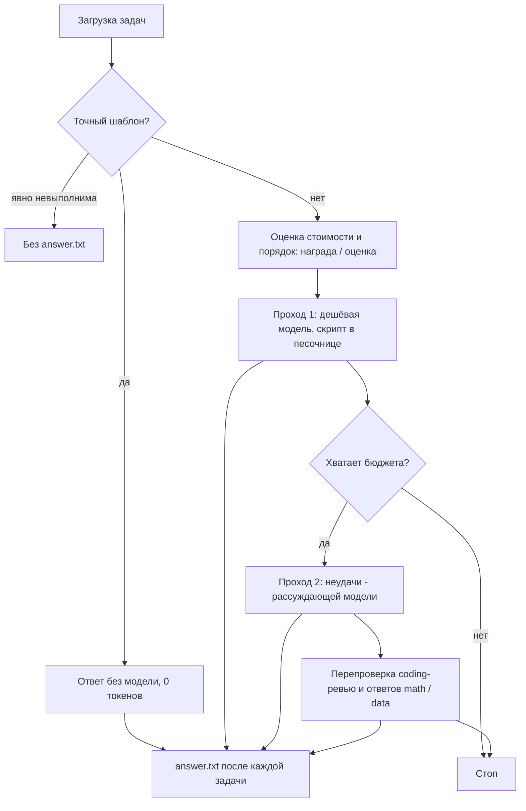

# Undefined Behavior Team: агент для задач с бюджетом токенов на openJiuwen

Харнесс для соревнования НГУ (кейс Budget-Aware Token Estimation for Agentic AI). Задача:
за фиксированный бюджет токенов решить как можно больше задач (math, search, data analysis,
coding), не тратить токены на невыполнимые и при равных баллах потратить меньше.

Основная идея у нас простая: модель вызываем только там, где без неё никак, и стараемся
обойтись одним коротким вызовом на задачу.

1. Задачи с типовыми формулировками решаются по шаблонам без модели (0 токенов), там же
   отсеиваются явно невыполнимые.
2. Для остальных модель пишет один короткий Python-скрипт, мы запускаем его в песочнице и
   берём ответ из последней строки вывода. Если скрипт упал, модель один раз его чинит.
3. В coding тесты гоняем локально до и после правки, это бесплатно. В `workspace/` правка
   попадает только при зелёных тестах.
4. `answer.txt` пишется сразу после каждой задачи, так что при остановке прогона уже
   решённое не теряется.

## Сборка и запуск

Сборка:

```bash
docker build -t "hack:latest" .
```

Запуск - команда из регламента:

```bash
timeout -k 1000s 1h docker run --rm --name "run-${TEAM}" \
  --network hack-net \
  -e LLM_BASE_URL -e LLM_API_KEY \
  -v "$TASKS:/data/tasks:rw" \
  --read-only --tmpfs /tmp:rw,size=2g -e HOME=/tmp \
  --cap-drop ALL --security-opt no-new-privileges \
  --cpus 8 --memory 16g --pids-limit 512 \
  --workdir /app --entrypoint python \
  "hack:latest" \
  /app/run_agent.py --tasks-dir /data/tasks
```

Мы проверяли запуск именно с этими флагами: корень только на чтение, рабочий каталог `/app`,
писать можно только в `/tmp` и в каталог задач. Образ около 1 ГБ, собирается за 2-3 минуты.
Базовый образ `python:3.11.11-slim-bookworm`, все зависимости зафиксированы в `requirements.lock`
(полный `pip freeze`, ставится с `--no-deps`). Ключей в репозитории нет.

Переменные окружения:

| Переменная | По умолчанию | Что это |
| --- | --- | --- |
| `LLM_BASE_URL`, `LLM_API_KEY` | - | адрес и ключ прокси |
| `BUDGET` | 100000 | бюджет в конкурсных токенах |

Без `LLM_API_KEY` агент не падает, а решает только то, что можно без модели. Незнакомые
аргументы командной строки игнорируются.

Ответ пишется в `answer.txt` рядом с `task.json`. Для невыполнимой задачи файл не создаём.
Запись атомарная (сначала во временный файл, потом переименование).

## Как устроен прогон



Каждая фаза каждой задачи выполняется как openJiuwen `Workflow` из цепочки компонентов
`solve -> publish` (`workflow.py`). Если фреймворк недоступен или упал, те же шаги выполняются
напрямую, чтобы сбой фреймворка не стоил решённой задачи. Свой HTTP-клиент к прокси мы оставили,
потому что нужен точный учёт токенов по каждому запросу и своя обработка 429.

Пара особенностей openJiuwen, которые пришлось обойти:

- при импорте он создаёт `./logs`, а `/app` в официальном запуске только на чтение, поэтому перед
  импортом процесс переходит в `/tmp`;
- по умолчанию он отменяет весь workflow через 60 секунд, и медленный ответ модели терял задачу.
  Этот лимит мы выключили, у наших шагов свои таймауты (HTTP, песочница, потолок токенов на задачу);
- логи фреймворка уходят в stderr, stdout остаётся для итоговой сводки.

## Модели

| Где | Модель |
| --- | --- |
| Точные шаблоны | без модели |
| Проход 1, все остальные задачи | `qwen3.8-27b-noreason` |
| Проход 2, задачи, которые не получились | `qwen3.8-27b` (с рассуждениями) |
| Перепроверка LLM-ответов math и data | `qwen3.8-27b` |
| Coding, где видимые тесты уже проходят или их нет | `qwen3.8-27b`, если бюджета хватает с запасом, иначе `noreason` |

Дешёвая модель без рассуждений решает большую часть задач при самом низком расходе.
Рассуждающая дороже примерно в 2 раза, поэтому её зовём только туда, где ошибка дешёвой
не видна по тестам: неверная формула в math или data выполняется без ошибок, а в coding
без падающих тестов единственный судья - текст задачи. Модели `qwen3.6-35b-a3b*` у нас
выходили и хуже, и дороже, их не используем.

## Оценка расхода токенов

Расход вызова считаем как в регламенте: $\text{prompt} / 10 + \text{completion}$, рассуждения
входят в completion. Вход неудачного запроса (429, 5xx, таймаут) тоже списываем: прокси его
учитывает.

Априорная оценка задачи (`planner.py`):

$$\text{оценка} = \text{вызовы} \cdot (\text{токены промпта} / 10 + \text{ожидаемый выход})$$

Токены промпта считаются по тому промпту, который реально уйдёт в модель (около 3.7 символа
на токен). Ожидаемый выход и число вызовов подобраны по нашим траекториям отдельно для
data/math, базы знаний и coding.

Как это используется:

- задачи идут по убыванию $\text{награда} / \text{оценка}$, поэтому если бюджет кончится,
  самые выгодные уже решены;
- по ходу прогона оценка подстраивается: для каждого типа задач считаем, во сколько раз факт
  отличается от оценки на уже решённых задачах этого набора;
- задача, которая не влезает в остаток, не выбрасывается, а пробуется в конце, начиная с самых
  дешёвых (если прогон остановят по бюджету, мы ничего не теряем);
- на задачу есть потолок: $\max(600, 6 \cdot \text{оценка})$, для coding $\max(1500, 15 \cdot \text{оценка})$;
- второй проход и перепроверка тратят только то, что осталось после первого прохода по всем
  задачам.

Параллельно идут 2 запроса. После 429 параллельность снижается и больше не растёт, `Retry-After`
выдерживается всеми потоками. Если прокси отвечает 401/402/403 или ошибкой про бюджет, модель
отключается, а уже записанные ответы остаются.

## Награда и усилия

Награды у задач случайные и со сложностью не связаны, поэтому усилия распределяем по
ожидаемой выгоде:

- порядок решения - по награде на токен (см. выше);
- бесплатная предпроверка невыполнимости не применяется к задачам из верхней четверти по
  награде, чтобы случайно не выкинуть дорогую задачу;
- coding-задачу, где тесты не сдвинулись после правки, повторно пробуем рассуждающей моделью
  только если её награда не ниже медианы.

## Поиск невыполнимых задач

1. Без модели: нет нужного файла или колонки, сущности нет в базе знаний, у сущности нет
   нужного поля, неоднозначные дубликаты. Для нешаблонных формулировок есть предпроверка:
   имя человека или организации из вопроса не встречается ни в одном файле базы знаний.
2. Моделью: системный промпт требует печатать `UNSOLVABLE`, если ответ нельзя получить из
   данных, и запрещает додумывать недостающие величины. Такой ответ не публикуется и второму
   мнению не отдаётся.
3. В coding: если после правки падают те же тесты, попытки прекращаются (обычно это
   противоречивые тесты).

Штрафа за неверный ответ нет, поэтому лучший найденный ответ мы публикуем всегда.
Невыполнимость важна в основном для экономии токенов.

## Безопасность

- Код модели выполняется в отдельном процессе во временной копии `workspace/`: входные файлы не
  меняются, в окружении нет ключа и адреса прокси, есть лимиты времени, памяти, CPU и размера
  файлов, по таймауту убивается вся группа процессов.
- В coding тестовые файлы менять нельзя, правки переносятся только после прохождения тестов.
- Содержимое файлов задачи передаётся модели внутри тегов `<untrusted_files>`, а системный
  промпт говорит, что там только данные. Так модель не выполняет подложенные в файлы
  инструкции.

## Траектории

Если задать каталог логов (`AGENT_LOG_DIR`), агент пишет туда `trajectories.jsonl` (строка
на задачу: итог, оценка и фактический расход, все вызовы модели с токенами, запуски скриптов
и тестов) и `summary.json` (сводка прогона). По собранным траекториям мы подбирали оценку
стоимости и выбор моделей. Сводки прогонов и пример траекторий лежат в `experiments/results/`
(формат описан в `experiments/README.md`).

## Структура

| Путь | Что |
| --- | --- |
| `run_agent.py` | точка входа |
| `src/nsu_budget_agent/main.py` | запуск: конфиг, рабочий каталог |
| `config.py` | аргументы и переменные окружения |
| `tasks.py` | загрузка задач |
| `runner.py` | триаж, порядок, проходы, отчёт |
| `planner.py` | оценка стоимости и подстройка по ходу прогона |
| `workflow.py` | интеграция с openJiuwen |
| `llm.py` | клиент к прокси, повторы, учёт токенов |
| `context.py` | компактное превью файлов задачи для модели |
| `sandbox.py`, `sandbox_lib/agentlib.py` | песочница и маленькая библиотека для скриптов модели (база знаний, markdown-таблицы, CSV) |
| `solvers/fastpath.py` | решатели точных шаблонов без модели и отсев невыполнимых |
| `solvers/precheck.py` | бесплатная предпроверка имён по базе знаний |
| `solvers/program.py` | общий решатель: скрипт за один вызов |
| `solvers/coding.py` | coding: тесты, правка, проверка |
| `publish.py` | запись `answer.txt` |
| `tools/` | генератор задач, грейдеры, запуск в контейнере, срез прогона по бюджету |
| `tests/` | модульные и сквозные тесты |

## Разработка

Это ветка для разработки. В `main` лежит только то, что нужно для сборки и запуска.

```bash
# образ для разработки (тот же Dockerfile)
docker build -t hack:dev .

# тесты без сети: LLM подменяется httpx.MockTransport
docker run --rm -v "$PWD:/repo:ro" -w /tmp -e PYTHONPATH=/repo/src:/repo/tests \
  --entrypoint python hack:dev -m unittest discover -s /repo/tests -t /repo/tests

# тренировочный набор (около 20% невыполнимых, ответы отдельно)
python3 tools/gen_tasks.py data/practice80 --n 80 --seed 11

# прогон в контейнере с флагами из регламента на копии задач, потом оценка
tools/dev_run.sh data/practice80/tasks my-run hack:dev
python3 tools/grade.py experiments/runs/my-run/tasks data/practice80/answers.json \
  --summary experiments/runs/my-run/logs/summary.json

# прогон без остановки -> балл при заданном бюджете
python3 tools/cut_at_budget.py my-run 100000
```

`tools/dev_run.sh` берёт ключ из `LLM_API_KEY` или из `../.env` и передаёт его только через
переменную окружения. Для замеров есть служебные переменные (`AGENT_LOG_DIR`,
`AGENT_STOP_AT_BUDGET`, выбор моделей и т.д.), их список в `config.py`.

CI (`.github/workflows/ci.yml`) на каждый пуш и PR: ruff и юнит-тесты, сборка образа с проверкой
времени (лимит 1000 с) и размера (лимит 4 ГБ), запуск командой из регламента без ключа и четыре
сквозных сценария `tools/e2e.sh` против поддельного LLM-сервера `tests/e2e/fake_llm.py`:

| Сценарий | Прокси | Что проверяем |
| --- | --- | --- |
| `full` | исправен | все ответы верные, тесты coding проходят, тесты и чужие файлы не тронуты, на невыполнимые нет `answer.txt` |
| `budget` | исправен, маленький `BUDGET` и остановка | прогон остановлен по бюджету, записанные ответы верны |
| `ratelimit` | 429, если в работе больше одного запроса | все ответы верны, отказов не больше 3 |
| `dead` | 402 на всё | бесплатный ответ есть, других нет, код выхода 0 |

Пересборка lock: собрать образ с `openjiuwen==0.1.19 httpx==0.28.1`, выполнить `pip freeze` и
добавить `setuptools` (`pip freeze` его не выводит, а `pymilvus` требует свежий).
